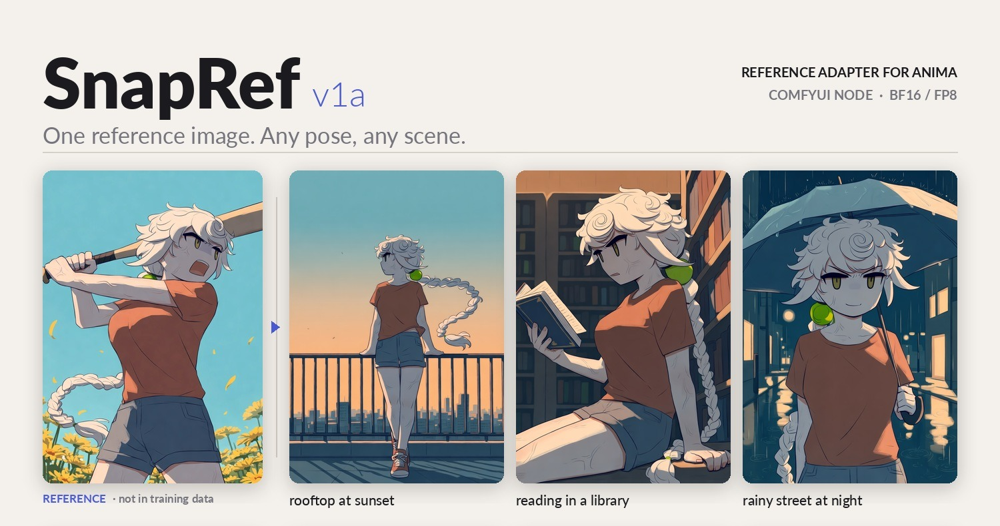
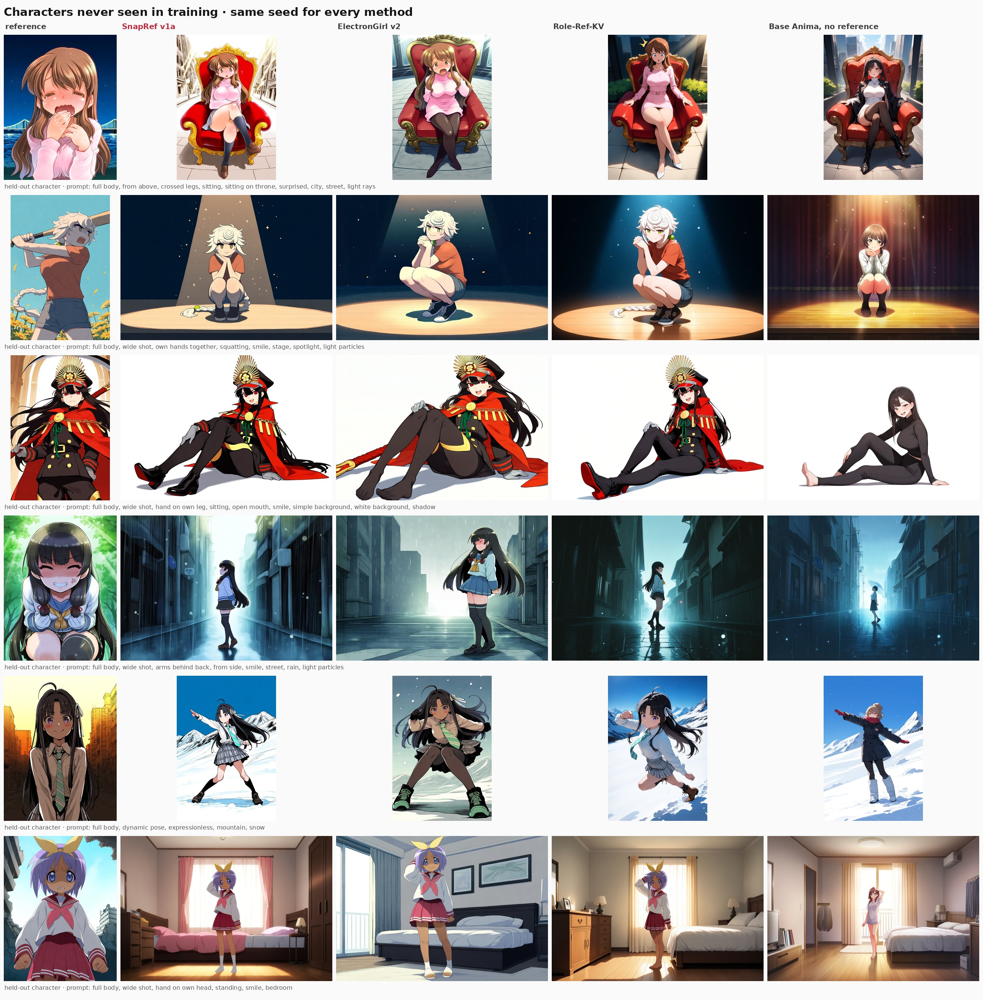
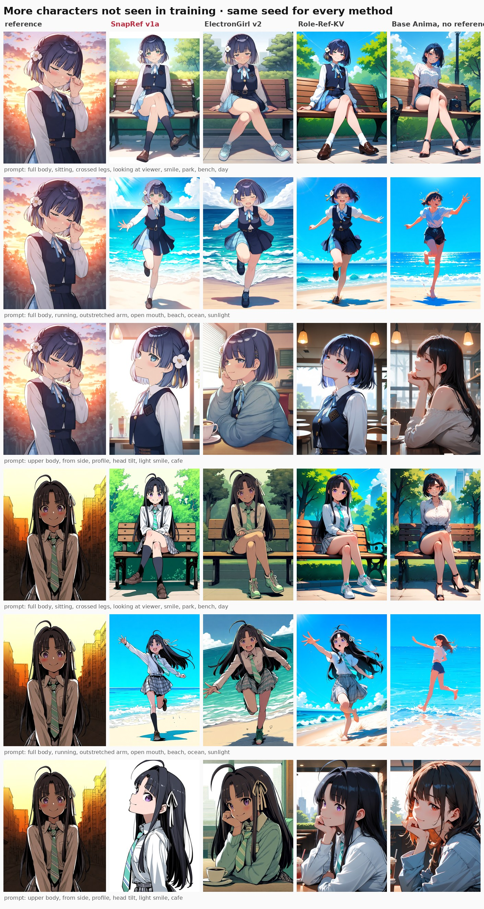
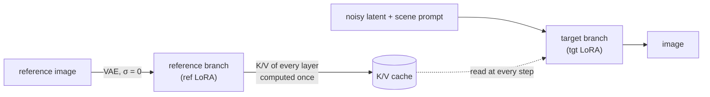

<p align="center">
  
</p>

<p align="center">
  <a href="https://huggingface.co/0ppxnhximxr/snapref-v1a"></a>
  <a href="https://huggingface.co/0ppxnhximxr/snapref-v1b"></a>
  
  
  
  
</p>

<p align="center">
  <b>Give Anima one picture of a character. Write only the scene.</b><br>
  Hair, eyes, outfit and style come from the reference, and they follow the new pose.
</p>

<p align="center">
  <a href="#quick-start">Quick start</a> ·
  <a href="#results">Results</a> ·
  <a href="#how-it-works">How it works</a> ·
  <a href="#training-it-yourself">Training</a> ·
  <a href="#roadmap">Roadmap</a>
</p>

---

This repository holds the training, data generation and evaluation code behind **SnapRef**, a reference adapter
for [Anima](https://huggingface.co/circlestone-labs/Anima) base v1.0. The released weights, ComfyUI node and
workflows are on Hugging Face: **[snapref-v1a](https://huggingface.co/0ppxnhximxr/snapref-v1a)** (recommended) and
**[snapref-v1b](https://huggingface.co/0ppxnhximxr/snapref-v1b)** (twice the LoRA rank).

## Highlights

|  |  |
|---|---|
| ⚡ **Fast** | The reference is encoded once and its keys/values are cached. Generation is about 15 % slower than plain Anima, and faster than the other Anima reference adapters. |
| 🎯 **Scene-only prompts** | No character name, appearance or artist tags. The reference carries them. |
| 🧩 **Drop-in node** | One ComfyUI node patches the model. Works with the bf16 and the FP8 Anima base. |
| 👥 **Two characters** | Stitch two references side by side and prompt `2girls`. |

## Quick start

1. Install Anima base v1.0 with its text encoder and VAE in ComfyUI.
2. Download the files from [Hugging Face](https://huggingface.co/0ppxnhximxr/snapref-v1a):
   - copy `comfyui/snapref/` to `ComfyUI/custom_nodes/`;
   - put `snapref_v1a.safetensors` (or the FP8 file) in `ComfyUI/models/loras/`.
3. Open `workflows/snapref_v1a.json`, load a reference image and queue.

```text
masterpiece, best quality, score_7, safe, 1girl, solo, full body, sitting, crossed legs, bench, street, night
```

> [!NOTE]
> SnapRef is not a regular LoRA. Load it with the **SnapRef** node, not with LoraLoader.
> All node settings are explained in the [model card](https://huggingface.co/0ppxnhximxr/snapref-v1a#settings).

## Results

<p align="center"></p>
<p align="center"><sub>Characters that were not in the training data. Every method gets the same prompt and seed; the prompt describes only the scene.</sub></p>

<details>
<summary><b>More held-out characters</b></summary>
<p align="center"></p>
</details>

Measured on 32 held-out characters (52 cases in total, same seeds), see
[`train/score_panels.py`](train/score_panels.py):

| | **SnapRef v1a** | ElectronGirl v2 | Anima, no reference |
|---|---:|---:|---:|
| DINOv2 similarity to the true image of the character ↑ | **0.722** | 0.675 | 0.493 |
| CLIP similarity to the true image ↑ | **0.863** | 0.844 | 0.670 |
| seconds per image, A100, 832×1216, 28 steps ↓ | **8.9** | 14.4 | 7.7 |
| held-out loss identity gap ↑ | **0.0040** | – | – |

<sub>The "true image" is another picture of the same held-out character in the prompted pose. Role-Ref-KV was
timed at 12.5 s on the same setup.</sub>

## How it works



- **Asymmetric attention.** The target tokens attend to themselves and to the cached reference. The reference
  never attends to the target, so it can be computed once, before sampling starts.
- **Two LoRAs.** The reference branch and the target branch each have their own LoRA (v1a: rank 128 and 64).
- **Separate position.** The reference sits at its own place in the model's RoPE coordinates, so it is read for
  appearance and not copied as a layout.
- **Training data.** 58,300 images generated with Anima itself (`scenes3x4`): 2,367 characters, each drawn in
  several scenes and poses in one artist style. The training prompt leaves out what the reference supplies.

## Training it yourself

```bash
# 1. data: scenes x poses per character, rendered with ComfyUI (one worker per GPU)
PROJECT_ROOT=$PWD bash deploy/run_scenes3x4.sh production
# 2. text contexts + latents -> safetensors, then train, preview and compare every checkpoint
GPUS=0,1 FIRST=v1a bash deploy/train_pipeline.sh   # configs/train_asym_<name>.json
# 3. score a comparison run
python train/score_panels.py RUN_A RUN_B --label a b --out scores.json
```

| path | |
|---|---|
| `train/asym.py` | asymmetric attention, reference K/V cache, the two LoRAs |
| `train/prepare_asym.py`, `train/train_asym.py` | tensor preparation and training |
| `train/eval_asym.py`, `train/compare_refs.py`, `train/score_panels.py` | held-out loss gaps, side-by-side runs against other adapters, embedding scores |
| `train/anima_env.py`, `train/sample.py`, `train/preview.py`, `train/prepare*.py` | model plumbing on top of ComfyUI, sampling, in-training previews, shared data helpers |
| `comfyui_nodes/snapref/` | the ComfyUI node (bf16 and FP8) |
| `datagen/` | tag catalogs, scene manifests, pose extension, ComfyUI batch workflow and GPU worker |
| `configs/` | the configs of the released runs: `datagen_scenes.json`, `train_asym.json` (v1a), `train_asym_v1b.json` |
| `comfyui_nodes/anima_ref_datagen_nodes/` | batched generation nodes used to render the training data |
| `deploy/` | GPU box setup, data generation launcher, training pipeline, FP8 conversion |

Data generation and training of v1a together took about 120 H100 GPU-hours.

## Roadmap

- [x] **v1a**: asymmetric attention + K/V cache, 58k generated images. Released.
- [x] **v1b**: twice the LoRA rank. Keeps the character as well as v1a and follows the prompt slightly more closely.
  Released as [snapref-v1b](https://huggingface.co/0ppxnhximxr/snapref-v1b).
- [ ] **v2**: generated images cut to half or less, real Danbooru-style illustrations added (100–150k images in total),
  outfit-change pairs and multi-resolution training. Goal: better results with real artwork as the reference and
  finer details (accessories, patterns, skin tone).

## Compatibility and troubleshooting

- **Black image with an fp16 model or `--fast`.** Fixed in the node update of 2026-10-31. Anima overflows in
  fp16. ComfyUI runs the model in fp16 when the checkpoint is stored in fp16 (many merges), with `--fp16-unet`,
  or with `--fast` / `--fast fp16_accumulation`. The old node encoded the reference in fp16 there and produced NaN.
  The new node keeps that part in fp32, as ComfyUI itself does. bf16 output is unchanged (same bits). With the
  old node, add `--bf16-unet` to the ComfyUI launch arguments, or drop `fp16_accumulation` from `--fast`.
- **Anzhc Mod Guidance:** works in either node order with the updated node. Before, applying Mod Guidance first
  dropped the reference.
- **Spectrum:** works with `ref_guidance_on` off. With it on, Spectrum-type step forecasting breaks; the node now
  logs a warning.
- **sorryhyun Mod Guidance:** with the default settings it can stop with a tensor-size error (4 vs 2). Turning on
  `ref_in_uncond` or `ref_guidance_on` avoids it.

## Known limitations

- Very small details (earrings, fine patterns, scars) can be simplified.
- A dark-skinned reference can come out with lighter skin.
- A scene can override the reference outfit (*beach* → swimsuit). Raise `strength` or name the outfit.

## Credits

This project started as a fork of ElectronGirl's
[anima-ref-adapter-research](https://github.com/ElectronGirl/anima-ref-adapter-research) and
[ComfyUI-Anima-Ref-Adapter](https://github.com/ElectronGirl/ComfyUI-Anima-Ref-Adapter), whose early work showed
that Anima can read a reference image this way. Their original code and README are in the first commit of this
repository's history.

## License

- **Code:** Apache-2.0 ([LICENSE](LICENSE)).
- **Weights:** a derivative of the CircleStone Model, under the CircleStone Labs Non-Commercial License v1.2
  (see the [model card](https://huggingface.co/0ppxnhximxr/snapref-v1a)). Images generated with Anima are
  subject to that license as well. Not affiliated with or endorsed by CircleStone Labs.
